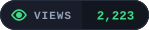

<div align="center">

<a href="https://adrix.is-a.dev"></a>

<a href="https://adrix.is-a.dev"></a>
<a href="mailto:vadityamishra777@gmail.com"></a>
<a href="https://www.linkedin.com/in/2b-adrix"></a>
<a href="https://x.com/AdityaMishraSu1"></a>



</div>

## `01` · Identity & Engineering Profile

I engineer **native Android applications and the backend services behind them** — clean Jetpack Compose UIs, resilient mobile architectures, and scalable REST APIs.

```kotlin
object Adrix : Engineer(
    name = "Aditya Kumar Mishra",
    handle = "2b-adrix",
    location = "India",
    education = "B.Tech CSE · Mewar University '28",
    team = "Alpha-coders",
) {
    val focus = listOf("Native Android", "Jetpack Compose", "Clean Architecture", "App Security")
    val stack = listOf("Kotlin", "Java", "Spring Boot", "Firebase", "MongoDB")
    val motto = "Engineering products, not just projects."
}
```

## `02` · Tech Architecture


## `03` · Featured Builds

<p align="center">
  <a href="https://github.com/2b-adrix/Krishiva-Native"></a>
  <a href="https://github.com/2b-adrix/Arogyagrid"></a>
</p>
<p align="center">
  <a href="https://github.com/2b-adrix/SentinalX"></a>
  <a href="https://github.com/2b-adrix/Alpha-Chat-Native"></a>
</p>

<sub>→ explore all repositories & case studies at <a href="https://adrix.is-a.dev">adrix.is-a.dev</a> · <a href="https://github.com/2b-adrix?tab=repositories">GitHub</a></sub>

## `04` · GitHub Telemetry

<p align="center">
  
  
</p>
<p align="center">
  
  
</p>
<p align="center">
  
</p>
<p align="center">
  
</p>

## `05` · Live Activity Feed

<!--START_SECTION:activity-->
| When | | What |
| :-- | :-: | :-- |
| `Nov 22` | ⬆️ | Pushed to `main` in [2b-adrix/register](https://github.com/2b-adrix/register) |
| `Nov 22` | 🔀 | Opened PR [#62420](https://github.com/is-a-dev/register/pull/62420) in [is-a-dev/register](https://github.com/is-a-dev/register) |
| `Nov 22` | 🔀 | Opened PR [#1](https://github.com/2b-adrix/register/pull/1) in [2b-adrix/register](https://github.com/2b-adrix/register) |
| `Nov 07` | ⬆️ | Pushed to `master` in [2b-adrix/Phantom-Lens](https://github.com/2b-adrix/Phantom-Lens) |
| `Nov 07` | 🔀 | Opened PR [#1](https://github.com/2b-adrix/Phantom-Lens/pull/1) in [2b-adrix/Phantom-Lens](https://github.com/2b-adrix/Phantom-Lens) |
| `Nov 05` | ⬆️ | Pushed to `main` in [2b-adrix/arogyagrid-backend](https://github.com/2b-adrix/arogyagrid-backend) |
| `Nov 05` | ⬆️ | Pushed to `main` in [2b-adrix/Arogyagrid](https://github.com/2b-adrix/Arogyagrid) |
| `Nov 03` | 🚀 | Released [v1.0.0](https://github.com/2b-adrix/Arogyagrid/releases/tag/v1.0.0) in [2b-adrix/Arogyagrid](https://github.com/2b-adrix/Arogyagrid) |
<!--END_SECTION:activity-->

## `06` · Contribution Matrix

<p align="center">
  
</p>

<details>
<summary><b>More Profiles & Competitive Coding</b></summary>
<br />

<a href="https://instagram.com/2b_adrix"></a>
<a href="https://www.leetcode.com/2b_adrix"></a>

</details>

<br />


