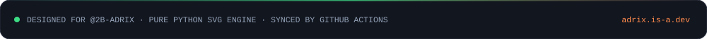

### About

Computer Science undergraduate (**Mewar University '28**) focused on building production-grade native Android software and dependable backend services.

- **Native Android:** Crafting responsive UIs in **Kotlin** and **Jetpack Compose** with clean MVVM architecture, Room persistence, and CameraX.
- **Security-First Mobile:** Integrating on-device ML (**TensorFlow Lite**), encrypted local storage (**SQLCipher**), and biometric authentication.
- **Backend & Systems:** Designing RESTful services with **Java / Spring Boot**, **MongoDB**, and **Firebase**, while sharpening DSA and system design.

### Featured Engineering

  
  

  
  

More repositories and architecture notes at <a href="https://adrix.is-a.dev">adrix.is-a.dev</a> · <a href="https://github.com/2b-adrix?tab=repositories">All repositories</a>

### Technical Stack

### GitHub Telemetry

  
  

  
  

  

  

### Recent Activity

<!--START_SECTION:activity-->
| When | | What |
| :-- | :-: | :-- |
| `Nov 22` | ⬆️ | Pushed to `main` in [2b-adrix/register](https://github.com/2b-adrix/register) |
| `Nov 22` | 🔀 | Opened PR [#62420](https://github.com/is-a-dev/register/pull/62420) in [is-a-dev/register](https://github.com/is-a-dev/register) |
| `Nov 22` | 🔀 | Opened PR [#1](https://github.com/2b-adrix/register/pull/1) in [2b-adrix/register](https://github.com/2b-adrix/register) |
| `Nov 07` | ⬆️ | Pushed to `master` in [2b-adrix/Phantom-Lens](https://github.com/2b-adrix/Phantom-Lens) |
| `Nov 07` | 🔀 | Opened PR [#1](https://github.com/2b-adrix/Phantom-Lens/pull/1) in [2b-adrix/Phantom-Lens](https://github.com/2b-adrix/Phantom-Lens) |
| `Nov 05` | ⬆️ | Pushed to `main` in [2b-adrix/arogyagrid-backend](https://github.com/2b-adrix/arogyagrid-backend) |
| `Nov 05` | ⬆️ | Pushed to `main` in [2b-adrix/Arogyagrid](https://github.com/2b-adrix/Arogyagrid) |
| `Nov 03` | 🚀 | Released [v1.0.0](https://github.com/2b-adrix/Arogyagrid/releases/tag/v1.0.0) in [2b-adrix/Arogyagrid](https://github.com/2b-adrix/Arogyagrid) |
<!--END_SECTION:activity-->

### Contribution Graph

  

<b>Additional Profiles</b>

 

 

