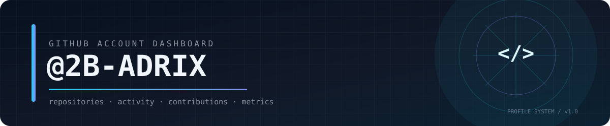
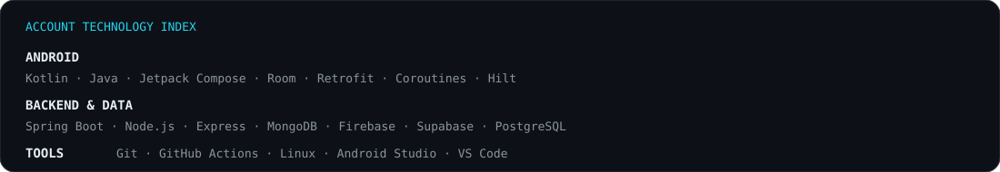

  
    
  <a href="https://adrix.vercel.app">Portfolio</a> ·
  <a href="mailto:vadityamishra777@gmail.com">Email</a> ·
  <a href="https://www.linkedin.com/in/2b-adrix">LinkedIn</a> ·
  <a href="https://x.com/adityamishrasu1">X / Twitter</a> ·
  <a href="https://www.leetcode.com/2b_adrix">LeetCode</a> ·
  <a href="https://instagram.com/2b_adrix">Instagram</a>

$ cat ~/account.yaml
apiVersion: github.profile/v1
kind: AccountDashboard
metadata:
  username: 2b-adrix
  profile: https://github.com/2b-adrix
spec:
  dashboard:
    repositories: public
    activity: recent-public-events
    statistics: generated-by-github-actions
    languages: aggregated-from-public-repositories
    contributions: rolling-12-months
  refresh:
    schedule: every-12-hours
    manual: workflow_dispatch
  cards:
    - stats
    - streak
    - languages
    - commit-clock
    - contributions
    - milestones
$ ls ~/toolkit
$ ls ~/repositories --featured
Repository	Description	Links
ArogyaGrid	Public-health supply-chain project focused on hospital inventory visibility and medicine redistribution.	App / main repo · Backend
SentinalX	Android cybersecurity project exploring installed-app checks and website defacement detection.	Repository
AlphaChat Native	Native chat application project with real-time communication and backend integration.	Repository
Phantom Lens	Application engineering project.	Repository

Browse the complete account: <a href="https://github.com/2b-adrix?tab=repositories">all repositories</a> · <a href="https://github.com/2b-adrix?tab=stars">stars</a> · <a href="https://github.com/2b-adrix?tab=activity">activity</a>
$ gh stats --user 2b-adrix

  
  

  
  

  

  

$ tail -n 8 ~/activity.log
<!--START_SECTION:activity-->
When		What
Waiting	◌	Run the dashboard workflow to load recent public GitHub activity here.

<!--END_SECTION:activity-->

<b><code>$ cat ~/.links</code></b>
- Portfolio
- LinkedIn
- LeetCode
- Instagram
- X / Twitter
- Email

  Dashboard cards are generated from GitHub's API and published by GitHub Actions.

