<div align="center">

<a href="https://adrix.is-a.dev"></a>

<a href="https://adrix.is-a.dev"></a>
<a href="mailto:vadityamishra777@gmail.com"></a>
<a href="https://www.linkedin.com/in/2b-adrix"></a>
<a href="https://x.com/AdityaMishraSu1"></a>
<br />


</div>

### `$ cat ~/about.md`

I engineer **native Android applications and the backend services behind them** — clean Jetpack Compose UIs, resilient mobile architectures, and scalable REST APIs.

```yaml
apiVersion: v1
kind: Engineer
metadata:
  name: aditya-kumar-mishra
  handle: 2b-adrix
  location: India 🇮🇳
spec:
  role: Android Developer & Backend Engineer
  education: B.Tech CSE — Mewar University '28
  team: Alpha-coders
  focus: [native-android, clean-architecture, app-security, backend-apis]
  daily_driver: [kotlin, jetpack-compose, java, spring-boot, firebase, mongodb]
  practicing: Data Structures & Algorithms (Java) · System Design
status:
  phase: Building
  motto: "Engineering products, not just projects."
```

### `$ ls ~/toolkit`



### `$ ls ~/projects --featured`

<p align="center">
  <a href="https://github.com/2b-adrix/Krishiva-Native"></a>
  <a href="https://github.com/2b-adrix/Arogyagrid"></a>
</p>
<p align="center">
  <a href="https://github.com/2b-adrix/Phantom-Lens"></a>
  <a href="https://github.com/2b-adrix/Alpha-Chat-Native"></a>
</p>

<sub>→ more repositories & case studies at <a href="https://adrix.is-a.dev">adrix.is-a.dev</a> · <a href="https://github.com/2b-adrix?tab=repositories">all GitHub repos</a></sub>

### `$ gh stats --user 2b-adrix`

<p align="center">
  
  
</p>
<p align="center">
  
  
</p>
<p align="center">
  
</p>
<p align="center">
  
</p>

### `$ tail -n 8 ~/activity.log`

<!--START_SECTION:activity-->
| When | | What |
| :-- | :-: | :-- |
| `Nov 22` | ⬆️ | Pushed to `main` in [2b-adrix/register](https://github.com/2b-adrix/register) |
| `Nov 22` | 🔀 | Opened PR [#62420](https://github.com/is-a-dev/register/pull/62420) in [is-a-dev/register](https://github.com/is-a-dev/register) |
| `Nov 22` | 🔀 | Opened PR [#1](https://github.com/2b-adrix/register/pull/1) in [2b-adrix/register](https://github.com/2b-adrix/register) |
| `Nov 07` | ⬆️ | Pushed to `master` in [2b-adrix/Phantom-Lens](https://github.com/2b-adrix/Phantom-Lens) |
| `Nov 07` | 🔀 | Opened PR [#1](https://github.com/2b-adrix/Phantom-Lens/pull/1) in [2b-adrix/Phantom-Lens](https://github.com/2b-adrix/Phantom-Lens) |
| `Nov 05` | ⬆️ | Pushed to `main` in [2b-adrix/arogyagrid-backend](https://github.com/2b-adrix/arogyagrid-backend) |
| `Nov 05` | ⬆️ | Pushed to `main` in [2b-adrix/Arogyagrid](https://github.com/2b-adrix/Arogyagrid) |
| `Nov 03` | 🚀 | Released [v1.0.0](https://github.com/2b-adrix/Arogyagrid/releases/tag/v1.0.0) in [2b-adrix/Arogyagrid](https://github.com/2b-adrix/Arogyagrid) |
<!--END_SECTION:activity-->

### `$ ./snake --dark`

<p align="center">
  
</p>

<details>
<summary><b><code>$ cat ~/.socials</code></b></summary>
<br />

<a href="https://instagram.com/2b_adrix"></a>
<a href="https://www.leetcode.com/2b_adrix"></a>

</details>

<br />


