  

  

---

## 👨‍💻 About Me

I'm **Aditya Kumar Mishra**, a Computer Science student focused on building reliable, scalable native Android applications.

- 🎓 B.Tech in Computer Science and Engineering — Mewar University.
- 📱 Focused on **Android development with Kotlin and Jetpack Compose**.
- 🧱 Interested in clean architecture, app security, performance, and backend engineering.
- ☁️ Exploring backend development with Spring Boot, REST APIs, and databases.
- 🤝 Open to meaningful collaborations, feedback, and engineering challenges.
- 📫 **Email:** [vadityamishra777@gmail.com](mailto:vadityamishra777@gmail.com)
- 🌐 **Portfolio:** [adrix.vercel.app](https://adrix.vercel.app)
- 💼 **LinkedIn:** [linkedin.com/in/2b-adrix](https://www.linkedin.com/in/2b-adrix)

## 🎯 Current Focus

- Deepening my understanding of Kotlin, Jetpack Compose, and Android architecture.
- Building maintainable Android applications with clear separation of concerns.
- Learning backend API development with Spring Boot.
- Practising Data Structures and Algorithms in Java.
- Improving system design, testing, debugging, and engineering documentation.

## 🛠 Tech Stack
## 📱 Android 

  

### 🌐 Web Development

### ⚙ Backend & Cloud

### 🐧 Systems & Tools

## 📚 Android Technologies

## 🔗 Connect with Me

  
  

  
  

  

  

## 📈 Developer Dashboard

  

## 📊 Developer Dashboard

 
## 💻 Development Metrics

## 🐍 Snake Eating My Contributions

