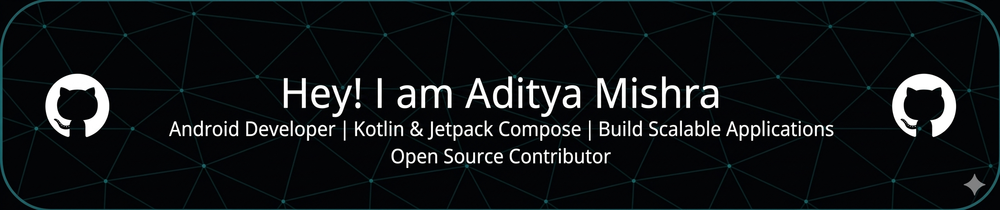

  

  

  

---

## 👨‍💻 About Me

- 🎓 3rd-year B.Tech Computer Science student.
- 📱 Focused on native Android development with Kotlin and Jetpack Compose.
- 🧱 Interested in clean architecture, app security, performance, and reliable backend systems.
- 🤝 Open to meaningful collaborations, feedback, and engineering challenges.
- 📫 **Email:** [vadityamishra777@gmail.com](mailto:vadityamishra777@gmail.com)
- 🌐 **Portfolio:** [adrix.vercel.app](https://adrix.vercel.app)

## 🌱 Currently Learning

- Android security and application architecture
- Kotlin, Jetpack Compose, Coroutines, and Flow
- Backend APIs with Spring Boot and MongoDB
- System design and scalable application development

---

## 🛠️ Tech Stack

### 📱 Android Development

  
  
  
  
  

### 🌐 Web Development

  
  
  

### ⚙️ Backend & Cloud

  
  
  

### 🐧 Systems & Tools

  
  
  
  

## 📚 Android Technologies

---

## 🔗 Connect With Me

  
  
  
  
  
  

---

## 📊 GitHub Statistics

  

  

## 📈 Developer Dashboard

  

## 💻 Development Metrics

  
  

---

## 🐍 Snake Eating My Contributions

  

