<div align="center">

<a href="https://adrix.is-a.dev"></a>

<a href="https://adrix.is-a.dev"></a>
<a href="mailto:vadityamishra777@gmail.com"></a>
<a href="https://www.linkedin.com/in/2b-adrix"></a>
<a href="https://x.com/AdityaMishraSu1"></a>
<br />


</div>

### `$ cat ~/about.md`

I build **native Android applications and the backend services behind them** — clean Jetpack Compose UIs, reliable architectures, and REST APIs. The goal is always the same: *engineering products, not just projects*.

```yaml
apiVersion: v1
kind: Engineer
metadata:
  name: aditya-kumar-mishra
  handle: 2b-adrix
  location: India 🇮🇳
spec:
  role: Android Developer & Backend Engineer
  education: B.Tech CSE — Mewar University '28
  team: Alpha-coders
  focus: [native-android, clean-architecture, app-security, backend-apis]
  daily_driver: [kotlin, jetpack-compose, java, spring-boot, firebase, mongodb]
  practicing: Data Structures & Algorithms (Java) · System Design
status:
  phase: Building
  motto: "Engineering products, not just projects."
```

### `$ ls ~/toolkit`


### `$ ls ~/projects --featured`

| Project | What it does | Built with |
| :-- | :-- | :-- |
| [**Krishiva-Native**](https://github.com/2b-adrix/Krishiva-Native) | AI-powered agricultural intelligence platform for farmers — instant crop disease diagnosis via Gemini AI & CameraX, real-time Mandi prices, and agronomy advice. | `Kotlin` `Jetpack Compose` `CameraX` `Gemini AI` |
| [**Arogyagrid**](https://github.com/2b-adrix/Arogyagrid) | Native Android healthcare client paired with a dedicated [Spring Boot backend](https://github.com/2b-adrix/arogyagrid-backend) for connected health workflows. | `Kotlin` `Java` `Spring Boot` `REST` |
| [**Phantom-Lens**](https://github.com/2b-adrix/Phantom-Lens) | Native Kotlin Android application exploring camera utilities and clean mobile architecture. | `Kotlin` `Android` `MVVM` |
| [**Alpha-Chat-Native**](https://github.com/2b-adrix/Alpha-Chat-Native) | Native real-time messaging Android app built with Kotlin and Firebase. | `Kotlin` `Android` `Firebase` |
| [**LeadGen_Hunter**](https://github.com/2b-adrix/LeadGen_Hunter) | Android lead-discovery and productivity utility built in Kotlin. | `Kotlin` `Android` |

<sub>→ more repositories & case studies at <a href="https://adrix.is-a.dev">adrix.is-a.dev</a></sub>

### `$ gh stats --user 2b-adrix`

<p align="center">
  
  
</p>
<p align="center">
  
  
</p>
<p align="center">
  
</p>
<p align="center">
  
</p>

### `$ tail -n 8 ~/activity.log`

<!--START_SECTION:activity-->
_Awaiting first GitHub Actions sync — activity updates automatically every 30 minutes._
<!--END_SECTION:activity-->

### `$ ./snake --dark`

<p align="center">
  
</p>

<details>
<summary><b><code>$ cat ~/.socials</code></b></summary>
<br />

<a href="https://instagram.com/2b_adrix"></a>
<a href="https://www.leetcode.com/2b_adrix"></a>

</details>
